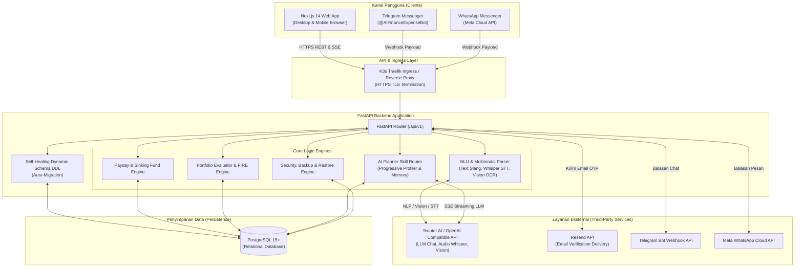
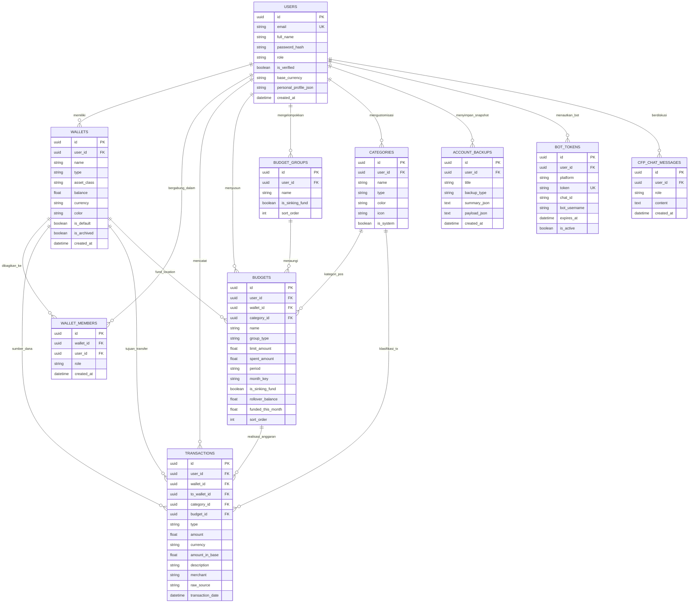
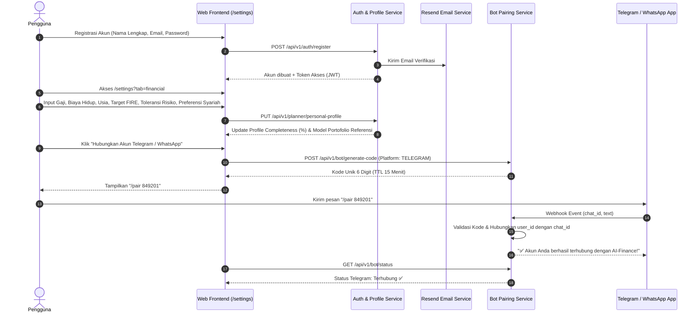
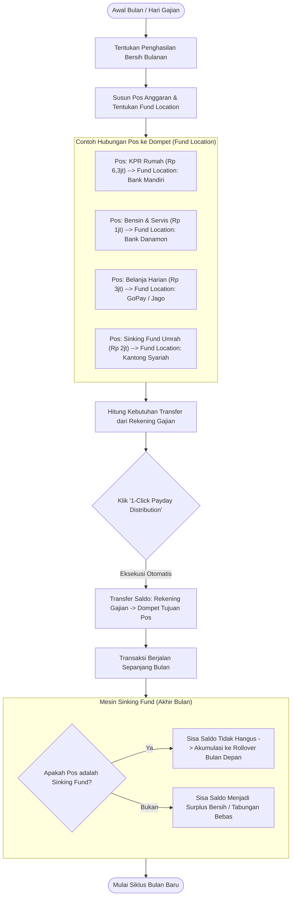
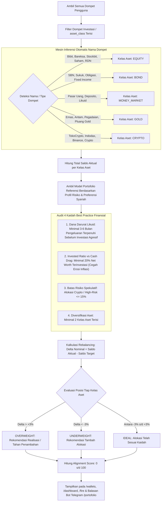
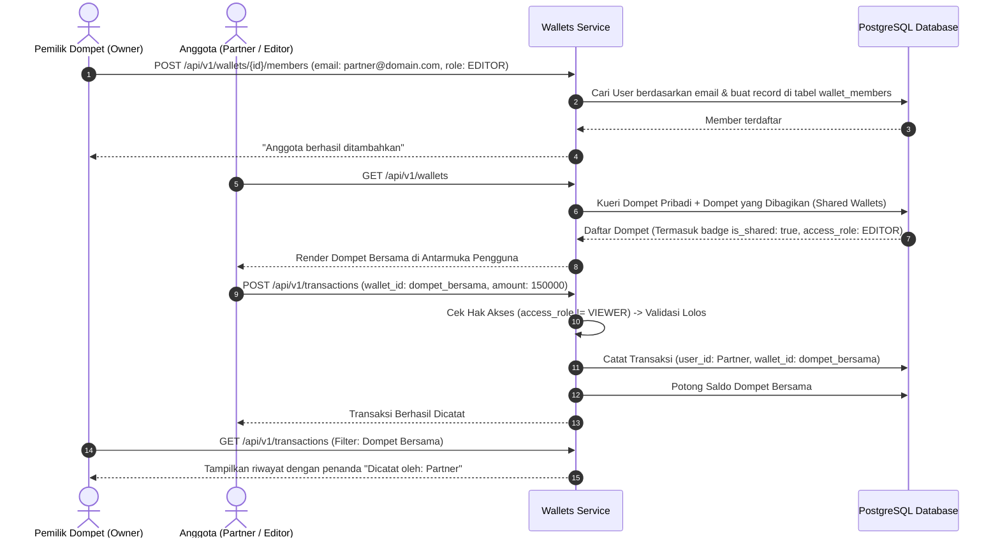
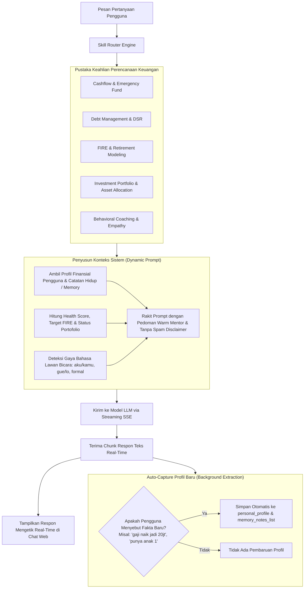
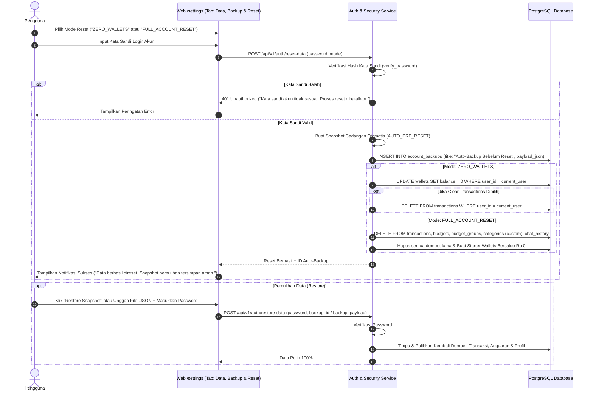

# AI-Finance: System Architecture, Logic Flows & Technical Documentation

Dokumen ini menyediakan spesifikasi teknis mendalam mengenai arsitektur sistem, pemodelan data relasional (ERD), alur logika bisnis (*business logic flows*), diagram alir pengguna (*user journey diagrams*), serta spesifikasi API untuk seluruh fitur di dalam ekosistem **AI-Finance**.

---

## 📑 Daftar Isi
1. [Arsitektur Sistem Tingkat Tinggi (High-Level Architecture)](#1-arsitektur-sistem-tingkat-tinggi)
2. [Diagram Relasi Entitas Database (Entity-Relationship Diagram / ERD)](#2-diagram-relasi-entitas-database-erd)
3. [Alur Logika & Diagram Fitur Sistem](#3-alur-logika--diagram-fitur-sistem)
   - [3.1. Onboarding Pengguna, Personalisasi Terpusat & Pairing Bot](#31-onboarding-pengguna-personalisasi-terpusat--pairing-bot)
   - [3.2. Zero-Based Payday Budgeting & Fund Location Linking](#32-zero-based-payday-budgeting--fund-location-linking)
   - [3.3. Multimodal Bot NLU & Operasi Semua Dompet (All-Wallet Ops)](#33-multimodal-bot-nlu--operasi-semua-dompet-all-wallet-ops)
   - [3.4. Review Portofolio Investasi & Audit Best Practice Finansial](#34-review-portofolio-investasi--audit-best-practice-finansial)
   - [3.5. Dashboard & Laporan Analitik Arus Kas Bulanan](#35-dashboard--laporan-analitik-arus-kas-bulanan)
   - [3.6. Dompet Bersama (Shared Wallets) & Role-Based Access Control](#36-dompet-bersama-shared-wallets--role-based-access-control)
   - [3.7. AI Financial Planner (Modular Skills & Progressive Profiling)](#37-ai-financial-planner-modular-skills--progressive-profiling)
   - [3.8. Keamanan Data, Backup/Restore & Password-Protected Reset](#38-keamanan-data-backuprestore--password-protected-reset)
   - [3.9. Admin Console & Top-Up Saldo Administratif](#39-admin-console--top-up-saldo-administratif)
4. [Kamus Spesifikasi API RESTful](#4-kamus-spesifikasi-api-restful)

---

## 1. Arsitektur Sistem Tingkat Tinggi

Sistem AI-Finance dibangun menggunakan arsitektur *client-server* modern yang memisahkan antarmuka pengguna interaktif (Next.js 14) dengan mesin logika bisnis dan orkestrasi AI (FastAPI Python).



---

## 2. Diagram Relasi Entitas Database (ERD)

Database PostgreSQL mengelola struktur relasional yang menghubungkan profil pengguna, dompet fisik/digital, pos anggaran, transaksi, hingga riwayat snapshot pencadangan.



---

## 3. Alur Logika & Diagram Fitur Sistem

### 3.1. Onboarding Pengguna, Personalisasi Terpusat & Pairing Bot

Alur pengguna saat membuat akun baru, melengkapi profil finansial terpusat, dan menautkan bot Telegram/WhatsApp:



---

### 3.2. Zero-Based Payday Budgeting & Fund Location Linking

Konsep inti alokasi anggaran: **Setiap pos memiliki dompet penempatan dana fisik (*Fund Location*)**. Ketika gajian tiba, fitur *Payday Distribution* menghitung dan mengeksekusi transfer dari rekening gajian ke dompet tujuan.



---

### 3.3. Multimodal Bot NLU & Operasi Semua Dompet (All-Wallet Ops)

Mesin Natural Language Understanding (NLU) mendukung pemrosesan teks kasual, transkripsi pesan suara (*Whisper*), dan OCR struk kasir (*Vision*).

```mermaid
flowchart TD
    MSG_IN[Pesan Masuk dari WA / Telegram] --> CLASSIFY{Tipe Konten Pesan}
    
    CLASSIFY -->|Audio / Voice Note| STT[Transkripsi Audio ke Teks via Whisper]
    CLASSIFY -->|Gambar / Foto Struk| OCR[Ekstraksi Merchant, Total & Item via Vision OCR]
    CLASSIFY -->|Teks Kasual| TEXT[Teks Pesan Langsung]

    STT --> NLU[NLU Parser Engine]
    OCR --> NLU
    TEXT --> NLU

    NLU --> INTENT{Deteksi Niat Transaksi / Perintah}

    INTENT -->|Command: /laporan| REP_CMD[Ambil Summary Bulanan -> Format Pesan Laporan -> Balas Chat]
    INTENT -->|Command: /portofolio| PORT_CMD[Ambil Review Portofolio & Best Practice -> Format Pesan -> Balas Chat]
    
    INTENT -->|Tambah Saldo / Topup| OP_ADD[Deteksi Dompet Tujuan & Nominal\nContoh: 'tambah saldo bibit 1jt'\nSaldo Dompet Bertambah (+)]
    
    INTENT -->|Kurangi Saldo / Tarik| OP_SUB[Deteksi Dompet Sumber & Nominal\nContoh: 'tarik dana bibit 500rb'\nSaldo Dompet Berkurang (-)]
    
    INTENT -->|Transfer Antar-Dompet| OP_TRF[Deteksi Dompet Asal & Tujuan\nContoh: 'transfer 1jt mandiri ke bibit'\nMutasi Saldo Asal (-) & Saldo Tujuan (+)]
    
    INTENT -->|Pencatatan Pengeluaran Harian| OP_EXP[Deteksi Kata Kunci Pos Anggaran & Merchant\nContoh: 'isi bensin 250rb']

    OP_EXP --> MATCH_BUDGET{Apakah Cocok dengan Pos Anggaran?}
    MATCH_BUDGET -->|Ya| DEDUCT_FUND_LOC[Otomatis Potong Dompet 'Fund Location' Terkait Pos Tersebut]
    MATCH_BUDGET -->|Tidak| DEDUCT_DEFAULT[Potong Dompet Default / Spesifik yang Disebut]

    OP_ADD --> SAVE_TX[Catat Record Transaksi ke Database]
    OP_SUB --> SAVE_TX
    OP_TRF --> SAVE_TX
    DEDUCT_FUND_LOC --> SAVE_TX
    DEDUCT_DEFAULT --> SAVE_TX

    SAVE_TX --> SEND_REPLY[Kirim Konfirmasi Balasan ke WhatsApp / Telegram]
```

---

### 3.4. Review Portofolio Investasi & Audit Best Practice Finansial

Sistem secara cerdas mengelompokkan dompet investasi ke dalam 5 kelas aset dan membandingkannya dengan kaidah perencanaan keuangan:



---

### 3.5. Dashboard & Laporan Analitik Arus Kas Bulanan

Alur pemrosesan data untuk menampilkan laporan summary bulanan di Web dan Telegram:

```mermaid
flowchart LR
    REQ[Request: GET /transactions/summary?month=YYYY-MM] --> PARSE_MONTH[Ekstraksi Rentang Tanggal Bulan Terpilih]
    
    PARSE_MONTH --> Q_CURR[Kueri Transaksi Bulan Terpilih (INCOME & EXPENSE)]
    PARSE_MONTH --> Q_PREV[Kueri Transaksi 1 Bulan Sebelumnya (Untuk Kalkulasi MoM%)]
    PARSE_MONTH --> Q_6M[Kueri Agregasi Bulanan 6 Bulan Terakhir (Untuk Bar Chart)]
    
    Q_CURR --> CALC_TOTALS[Hitung Total Pemasukan, Total Pengeluaran & Net Cashflow]
    CALC_TOTALS --> CALC_SR[Hitung Savings Rate % = Net Cashflow / Total Pemasukan * 100]
    
    Q_PREV --> CALC_MOM[Hitung Pertumbuhan MoM%: (Bulan Ini - Bulan Lalu) / Bulan Lalu * 100]
    
    Q_CURR --> CAT_GROUP[Kelompokkan Berdasarkan Kategori -> Hitung Persentase Distribusi]
    Q_CURR --> WALLET_GROUP[Kelompokkan Mutasi Masuk/Keluar per Dompet Aktif]
    
    CALC_TOTALS --> MERGE[Gabungkan ke Struktur MonthlyTransactionMetrics]
    CALC_SR --> MERGE
    CALC_MOM --> MERGE
    Q_6M --> MERGE
    CAT_GROUP --> MERGE
    WALLET_GROUP --> MERGE
    
    MERGE --> RES[Respons JSON Ringkasan Finansial Bulanan]
```

---

### 3.6. Dompet Bersama (Shared Wallets) & Role-Based Access Control

Mekanisme kolaborasi keuangan antar-pengguna (misal: dompet keluarga, kas bersama):



---

### 3.7. AI Financial Planner (Modular Skills & Progressive Profiling)

Arsitektur diskusi perencanaan keuangan berbasis *Server-Sent Events (SSE)*:



---

### 3.8. Keamanan Data, Backup/Restore & Password-Protected Reset

Prosedur pengamanan data dan mekanisme *factory reset* berperingkat keamanan tinggi:



---

### 3.9. Admin Console & Top-Up Saldo Administratif

Alur khusus peran administrator (`role == "ADMIN"`) untuk memantau integritas ekosistem dan intervensi saldo:

```mermaid
flowchart TD
    ADMIN_REQ[Admin Login & Akses /admin] --> AUTH_CHECK{Cek Hak Akses Pengguna}
    
    AUTH_CHECK -->|Bukan Admin| FORBIDDEN[Tolak Akses: 403 Forbidden]
    AUTH_CHECK -->|Role Admin| ALLOW[Beri Akses Admin Console]

    ALLOW --> STATS[GET /api/v1/admin/stats]
    STATS --> RENDER_STATS[Tampilkan Metrik: Total Pengguna, Email Terverifikasi, User Aktif 30 Hari, Total Saldo Seluruh Sistem, Total Transaksi, Adopsi Bot]

    ALLOW --> USERS_LIST[GET /api/v1/admin/users?search=...]
    USERS_LIST --> RENDER_USERS[Tampilkan Tabel Pengguna, Status Verifikasi, Jumlah Dompet & Transaksi]

    RENDER_USERS --> ACTION_TOPUP[Pilih Pengguna & Eksekusi Penyesuaian Saldo]
    ACTION_TOPUP --> EXEC_TOPUP[POST /api/v1/admin/users/{id}/topup]
    EXEC_TOPUP --> LOG_TX[Sistem Menambah Saldo Dompet Default & Mencatat Transaksi 'TOPUP / PENYESUAIAN ADMIN']
    LOG_TX --> NOTIF[Perbarui Saldo Pengguna Secara Real-Time]
```

---

## 4. Kamus Spesifikasi API RESTful

Seluruh rute API diawali dengan prefiks `/api/v1`:

| Modul | Method | Endpoint | Deskripsi & Parameter |
| :--- | :--- | :--- | :--- |
| **Auth** | `POST` | `/auth/register` | Mendaftarkan pengguna baru (wajib `full_name`, `email`, `password`) |
| | `POST` | `/auth/login` | Otentikasi pengguna, mengembalikan Bearer JWT Token |
| | `GET` | `/auth/profile` | Mengambil data profil pengguna yang sedang login |
| | `PUT` | `/auth/profile` | Memperbarui nama lengkap, email, atau mata uang acuan |
| | `PUT` | `/auth/change-password` | Mengubah kata sandi pengguna |
| | `GET` | `/auth/backups` | Mengambil daftar riwayat snapshot backup tersimpan |
| | `POST` | `/auth/backups` | Membuat Cloud Snapshot akun secara manual |
| | `GET` | `/auth/backups/{id}/export`| Mengunduh payload snapshot backup dalam format JSON |
| | `DELETE`| `/auth/backups/{id}` | Menghapus snapshot backup tertentu |
| | `POST` | `/auth/reset-data` | **Wajib Password**: Eksekusi `ZERO_WALLETS` atau `FULL_ACCOUNT_RESET` |
| | `POST` | `/auth/restore-data` | **Wajib Password**: Memulihkan data dari snapshot / payload JSON |
| **Wallets** | `GET` | `/wallets` | Mengambil daftar semua dompet (pribadi, bersama, investasi) + skor portofolio |
| | `POST` | `/wallets` | Membuat dompet baru (mendukung parameter `asset_class`) |
| | `PUT` | `/wallets/{id}` | Memperbarui informasi dompet atau kelas aset |
| | `DELETE`| `/wallets/{id}` | Menghapus / mengarsipkan dompet |
| | `POST` | `/wallets/transfer` | Memindahkan saldo antar-dompet secara internal |
| | `POST` | `/wallets/{id}/members` | Menambahkan anggota ke dompet bersama (`role: EDITOR/VIEWER`) |
| | `DELETE`| `/wallets/{id}/members/{uid}` | Menghapus akses anggota dari dompet bersama |
| | `GET` | `/wallets/portfolio-review` | Mengambil evaluasi mendalam portofolio investasi vs best practice |
| **Budgets** | `GET` | `/budgets` | Mengambil daftar alokasi anggaran bulanan (`?month=YYYY-MM`) |
| | `POST` | `/budgets` | Menambahkan pos anggaran baru dengan tautan Fund Location |
| | `PUT` | `/budgets/{id}` | Memperbarui nominal limit, pos sinking fund, atau dompet penempatan |
| | `DELETE`| `/budgets/{id}` | Menghapus pos anggaran |
| | `POST` | `/budgets/distribute-payday` | Eksekusi distribusi gajian 1-klik ke dompet tujuan pos |
| | `POST` | `/budgets/copy-month` | Menduplikasi susunan pos anggaran dari bulan sebelumnya |
| | `GET` | `/budgets/groups` | Mengambil daftar grup anggaran (`Living Needs`, `Lifestyle`, dll.) |
| | `POST` | `/budgets/groups` | Membuat grup anggaran custom baru |
| **Transactions** | `GET` | `/transactions` | Mengambil daftar transaksi dengan filter tipe, dompet, pos, dan `?month=YYYY-MM` |
| | `POST` | `/transactions` | Mencatat transaksi pengeluaran/pemasukan baru secara manual |
| | `DELETE`| `/transactions/{id}` | Menghapus transaksi dan mengembalikan saldo dompet |
| | `GET` | `/transactions/summary` | Mengambil analitik arus kas bulanan, MoM%, tren 6 bulan & distribusi |
| **Webhooks & Bot** | `POST` | `/webhooks/telegram` | Webhook penerima payload chat, audio, dan foto struk Telegram |
| | `POST` | `/webhooks/whatsapp` | Webhook penerima pesan masuk Meta WhatsApp Cloud API |
| | `POST` | `/webhooks/simulate-chat` | Simulator pengujian NLU langsung di browser |
| | `POST` | `/bot/generate-code` | Menghasilkan kode pairing 6 digit (berlaku 15 menit) |
| | `GET` | `/bot/status` | Mengecek status koneksi akun WhatsApp & Telegram |
| **Planner & FIRE** | `GET` | `/planner/health-score` | Mengambil skor kesehatan finansial, target FIRE, dan konteks profil |
| | `PUT` | `/planner/personal-profile` | Menyimpan preferensi finansial & akurasi personalisasi secara terpusat |
| | `POST` | `/planner/chat` | SSE Streaming endpoint untuk percakapan interaktif bersama AI Planner |
| | `GET` | `/planner/history` | Mengambil riwayat percakapan chat AI |
| | `DELETE`| `/planner/history` | Membersihkan riwayat obrolan |
| | `GET` | `/fire/profile` | Mengambil parameter Rule of 25, proyeksi pensiun, dan alokasi aset |
| | `POST` | `/fire/calculate` | Kalkulasi interaktif simulasi target angka FIRE kustom |
| **Admin** | `GET` | `/admin/stats` | Statistik agregat seluruh sistem (Khusus role ADMIN) |
| | `GET` | `/admin/users` | Daftar seluruh pengguna terdaftar beserta ringkasan keuangannya |
| | `POST` | `/admin/users/{id}/topup` | Penyesuaian / top-up saldo administratif ke akun pengguna terpilih |

---

*Dokumentasi ini disusun dan diperbarui secara otomatis seiring dengan evolusi basis kode AI-Finance.*
