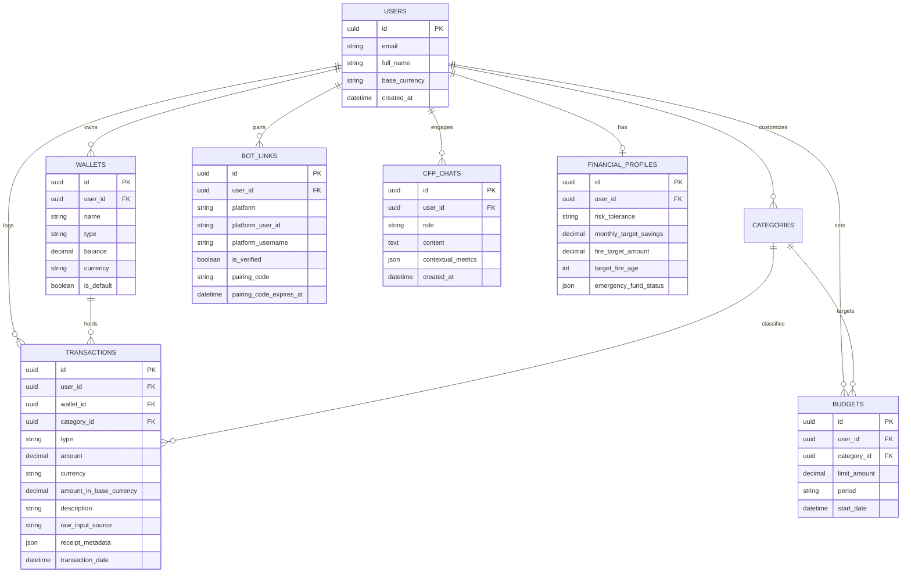

# PRD: AI-Finance Platform (Personal Finance & AI CFP Assistant)

**Version:** 1.0.0  
**Status:** Approved / Ready for Development  
**Target Platform:** Web App Responsive (Next.js), Chatbot (Telegram Bot & WhatsApp Cloud API), AI Backend Service (FastAPI)  
**Primary Currency:** Multi-currency (IDR & USD with dynamic/configurable exchange rates)

---

## 1. Introduction

Mengelola keuangan pribadi sering kali menjadi beban bagi banyak orang: pencatatan manual memerlukan disiplin tinggi dan memakan waktu, anggaran sering terabaikan, dan akses ke perencana keuangan bersertifikasi (*Certified Financial Planner* / CFP) membutuhkan biaya yang mahal.

**AI-Finance** adalah platform manajemen keuangan pribadi cerdas bertenaga AI yang menggabungkan:
1. **Zero-Friction Expense & Income Logging:** Pencatatan pengeluaran & pemasukan harian semudah mengirim pesan ke teman melalui Telegram dan WhatsApp via input teks kasual, rekaman suara (*voice note*), maupun foto struk belanjaan (*receipt OCR*).
2. **Multi-Wallet & Budgeting Engine:** Pengelolaan dompet statis multi-akun (Bank, E-Wallet, Cash, Investasi) dengan pelacak anggaran dinamis (*budget alerts*).
3. **AI Financial Planner (CFP) Assistant:** Konsultan finansial AI interaktif yang menganalisis kesehatan keuangan pengguna (*emergency fund ratio*, *debt service ratio*, *cash flow margin*), profil risiko, serta merancang peta jalan menuju **Financial Independence, Retire Early (FIRE)** melalui rekomendasi alokasi kelas aset (Saham, Reksa Dana, Obligasi/SBN, Emas, Crypto) dengan kepatuhan etika dan disclaimer finansial.
4. **Instant Financial Insights & Summaries:** Laporan berkala dan ringkasan kondisi finansial instan yang dapat diakses langsung dari dashboard web maupun chat Telegram/WhatsApp.

---

## 2. Goals & Non-Goals

### 2.1 Primary Goals
- Menyediakan metode pencatatan transaksi yang paling minim hambatan (*zero friction*) melalui bot Telegram dan WhatsApp multimodal.
- Memberikan konsultasi keuangan berkualitas CFP secara 24/7 dengan konteks data finansial pengguna secara *real-time* (*RAG + Financial Context Engine*).
- Membantu pengguna memvisualisasikan jalur menuju kebebasan finansial (*Financial Freedom*) melalui kalkulator simulasi FIRE interaktif dan alokasi aset terpersonalisasi.
- Memberikan visibilitas penuh terhadap *net worth*, distribusi pengeluaran, dan progres tabungan lintas mata uang (IDR & USD).

### 2.2 Secondary Goals
- Notifikasi peringatan dini ketika pengeluaran mendekati atau melampaui limit anggaran (*budget overrun notification*).
- Menghasilkan laporan berkala otomatis (mingguan/bulanan) dengan rangkuman *actionable* langsung ke aplikasi pesan pengguna.

### 2.3 Non-Goals (Out of Scope for Phase 1)
- Integrasi otomatis dengan Open Banking / Aggregator API (Brick, Plaid, BCA API, dll.). Semua dompet di Fase 1 bersifat statis (*manual/user-created*).
- Eksekusi transaksi pembelian saham/reksa dana secara langsung (*live broker execution*). AI bertindak sebagai advisor & planner edukatif, bukan entitas pialang/sekuritas.
- Rekomendasi *stock picking* harian berspekulasi tinggi / sinyal *day-trading*.

---

## 3. User Personas & User Stories

### 3.1 User Personas
1. **Dimas (27, Urban Professional):** Memiliki mobilitas tinggi, sering lupa mencatat pengeluaran harian. Ingin cara cepat catat pengeluaran di kasir atau warteg cukup dengan kirim voice note atau foto struk di WhatsApp/Telegram.
2. **Sarah (32, Mid-Career / Working Mom):** Ingin merencanakan dana darurat, asuransi, dan pendidikan anak, serta menargetkan pensiun dini di usia 45 tahun (*FIRE*). Membutuhkan *second opinion* layaknya CFP untuk mengevaluasi kesehatan portofolionya.

### 3.2 User Stories

#### Epik 1: Multi-Wallet & Account Setup
- **US-1.1 [Wallet Management]:** Sebagai user, saya ingin membuat beberapa dompet statis (misal: "BCA Utama", "GoPay", "Cash Dompet", "Bibit") dengan mata uang (IDR/USD) dan saldo awal, agar transaksi saya terorganisasi sesuai rekening riil saya.
  - *Acceptance Criteria:*
    - [ ] Sistem menyediakan wallet bawaan secara otomatis saat registrasi: Cash (IDR), Bank Utama (IDR), dan E-Wallet (IDR).
    - [ ] User dapat menambah, mengubah nama, ikon/warna, dan mengarsipkan wallet.
    - [ ] Saldo wallet ter-update secara otomatis saat ada transaksi pemasukan, pengeluaran, atau transfer antar-wallet.

#### Epik 2: Zero-Friction Chatbot Integration (Telegram & WhatsApp)
- **US-2.1 [Bot Pairing]:** Sebagai user, saya ingin menghubungkan akun web saya dengan Telegram bot dan WhatsApp bot menggunakan kode pairing 6-digit atau link aktivasi, agar pesan saya dikenali oleh sistem secara aman.
  - *Acceptance Criteria:*
    - [ ] Dashboard Web menyediakan halaman "Integrasi Chatbot" dengan tombol generate OTP Pairing Code / Deep Link Telegram.
    - [ ] Saat user mengirim `/pair [CODE]` di Telegram atau WhatsApp, akun berhasil terhubung dan bot mengirim pesan konfirmasi.
    - [ ] User dapat memutus (*unlink*) sesi bot sewaktu-waktu dari dashboard web.

- **US-2.2 [Multimodal Expense Logging via Chat]:** Sebagai user, saya ingin mencatat pengeluaran via chat menggunakan teks natural, rekaman suara (*voice note*), atau foto struk belanja, agar saya tidak perlu membuka form manual yang rumit.
  - *Acceptance Criteria:*
    - [ ] **Teks Natural:** Bot dapat mem-parsing kalimat santai seperti: *"Beli kopi kenangan 28rb pake gopay"* -> Category: Food & Beverage, Amount: 28,000 IDR, Wallet: GoPay.
    - [ ] **Voice Note:** Bot mentranskripsi audio menjadi teks menggunakan Whisper/Gemini Audio dan mengekstrak entitas finansial secara akurat.
    - [ ] **Foto Struk / Receipt:** Bot memproses gambar nota/struk via Gemini Vision OCR, mengekstrak total nominal, merchant, tanggal, dan rincian item utama.
    - [ ] Bot membalas dengan kartu konfirmasi interaktif: rincian nominal, kategori, dompet terpilih, dan tombol/opsi cepat konfirmasi atau batalkan (*undo*).

- **US-2.3 [Financial Quick Summary via Chatbot]:** Sebagai user, saya ingin meminta ringkasan pengeluaran langsung di chat (misal: *"Berapa pengeluaran makan minggu ini?"* atau *"Minta summary bulan ini"*), agar saya tahu posisi keuangan tanpa login ke web.
  - *Acceptance Criteria:*
    - [ ] Bot mengerti query agregasi berbasis waktu dan kategori.
    - [ ] Bot merespons dalam waktu < 3 detik dengan ringkasan visual format teks/markdown yang rapi.

#### Epik 3: Budgeting & Alerts
- **US-3.1 [Budgeting Engine]:** Sebagai user, saya ingin menentukan batas anggaran bulanan per kategori (misal: Makanan 3 Juta, Hiburan 1 Juta, Transportasi 1.5 Juta) serta anggaran global, agar pengeluaran saya terkendali.
  - *Acceptance Criteria:*
    - [ ] Indikator visual progres budget (*Progress bar* dengan indikator warna: Hijau < 70%, Kuning 70-90%, Merah > 90%).
    - [ ] Notifikasi otomatis terkirim via Web & Chatbot saat budget menyentuh 80% dan 100%.

#### Epik 4: AI Financial Planner (CFP) Assistant
- **US-4.1 [Interactive CFP Chatbot]:** Sebagai user, saya ingin berdiskusi dengan AI yang memiliki persona Certified Financial Planner di dashboard web, agar saya mendapatkan analisis keuangan komprehensif.
  - *Acceptance Criteria:*
    - [ ] AI memiliki akses ke profil finansial pengguna (*Read-only context injection*): total aset, total hutang, rata-rata pengeluaran bulanan, dan profil risiko.
    - [ ] Persona AI santun, profesional, analitis, edukatif, dan selalu menyertakan disclaimer kepatuhan finansial.
    - [ ] Mendukung streaming response (SSE / WebSocket) untuk pengalaman chat yang responsif.

- **US-4.2 [Financial Health Checkup]:** Sebagai user, saya ingin melihat skor kesehatan keuangan saya berdasarkan standar CFP (Emergency Fund Ratio, Debt Service Ratio, Savings Rate, Net Worth Growth).
  - *Acceptance Criteria:*
    - [ ] Dashboard menampilkan skor kesehatan finansial (Skala 0 - 100) dan status indikator:
      - *Emergency Fund:* 3-6x pengeluaran bulanan (lajang), 6-12x (berkeluarga).
      - *Debt Service Ratio (DSR):* Maksimal 30% dari penghasilan bulanan.
      - *Savings Rate:* Minimal 20% dari penghasilan.
    - [ ] Rekomendasi perbaikan spesifik dihasilkan oleh AI berdasarkan indikator yang merah/kuning.

- **US-4.3 [FIRE Calculator & Investment Roadmap]:** Sebagai user, saya ingin menghitung target dana pensiun/FIRE saya dan mendapatkan saran alokasi portofolio investasi (Saham, Reksa Dana, SBN, Emas, Crypto), agar saya memiliki strategi konkret menuju Financial Freedom.
  - *Acceptance Criteria:*
    - [ ] Kalkulator interaktif dengan input: Usia saat ini, target usia pensiun, estimasi pengeluaran bulanan di masa pensiun, laju inflasi, dan ekspektasi *return* tahunan.
    - [ ] Menampilkan simulasi modal akumulasi (*FIRE Number* dengan kaidah *Rule of 25 / 4% Safe Withdrawal Rate*).
    - [ ] AI CFP memberikan rekomendasi alokasi kelas aset yang disesuaikan dengan profil risiko pengguna (Konservatif, Moderat, Agresif).

---

## 4. Functional Requirements

### 4.1 Authentication & User Profiles
- **FR-1:** Registrasi & Login melalui Email/Password dan OAuth Google.
- **FR-2:** Pengaturan preferensi mata uang dasar pengguna (Default: IDR, alternatif: USD).
- **FR-3:** Pengaturan kuesioner profil risiko finansial (5-7 pertanyaan standar CFP).

### 4.2 Wallet & Transaction Engine
- **FR-4:** Dukungan operasi CRUD pada Wallet (Label, Tipe: Cash, Bank, E-Wallet, Investment, Credit/Loan; Saldo Awal, Mata Uang).
- **FR-5:** Pencatatan 3 tipe transaksi: *Expense* (Pengeluaran), *Income* (Pemasukan), dan *Transfer* (Pemindahan dana antar-wallet).
- **FR-6:** Kategori sistem standar (Makanan & Minuman, Transportasi, Belanja, Tagihan/Utilitas, Hiburan, Kesehatan, Pendidikan, Investasi, Lain-lain) serta kemampuan membuat kategori kustom.
- **FR-7:** Dukungan multi-currency: Transaksi dalam USD dapat dikonversi ke nilai ekuivalen IDR pada dashboard net worth berdasarkan kurs acuan.

### 4.3 Chatbot Parser Engine (AI & NLP Service)
- **FR-8:** Webhook handler untuk Telegram Bot API (`/webhook/telegram`) dan WhatsApp Cloud API (`/webhook/whatsapp`).
- **FR-9:** NLU & Entity Extractor:
  - Ekstraksi nominal (termasuk format slang: "50k", "50rb", "1.5jt", "$20").
  - Ekstraksi merchant & tujuan transaksi.
  - Ekstraksi dompet target berdasarkan nama/alias (misal "bca", "kantong utama", "gopay").
  - Ekstraksi tanggal/waktu transaksi (default: waktu pesan diterima).
- **FR-10:** Modul Audio Transcription: Menerima file `.ogg`/`.mp3` dari voice note Telegram/WA, ditranskripsi oleh Whisper API / Gemini Audio, lalu diteruskan ke NLP Extractor.
- **FR-11:** Modul Vision OCR: Menerima foto struk (JPEG/PNG), dianalisis dengan Gemini Multimodal Vision untuk ekstraksi itemized receipt dan total transaksi.
- **FR-12:** Konfirmasi interaktif: Pesan konfirmasi dengan waktu *timeout* (30 detik untuk pembatalan/edit).

### 4.4 AI Financial Planner (CFP) Core
- **FR-13:** RAG Context Assembler: Mengumpulkan ringkasan agregat 30-90 hari terakhir (Pemasukan rata-rata, Pengeluaran rata-rata per kategori, Saldo total semua wallet, Daftar cicilan/hutang aktif) sebagai *system prompt context* sebelum mengirim prompt ke LLM.
- **FR-14:** Guardrails & Disclaimer Finansial: Sistem wajib menyisipkan klausul disclaimer edukasi finansial pada setiap rekomendasi investasi.
- **FR-15:** Simulasi FIRE Engine: Formula matematis deterministik untuk kalkulasi nilai masa depan (*compound interest*) digabungkan dengan interpretasi naratif dari AI CFP.

### 4.5 Reporting & Analytics Dashboard
- **FR-16:** Tampilan visual Cashflow (Trend pemasukan vs pengeluaran berbasis waktu: harian, mingguan, bulanan).
- **FR-17:** Donut Chart alokasi pengeluaran per kategori dan per wallet.
- **FR-18:** Ekspor data transaksi ke format CSV / Excel.

---

## 5. Technical Architecture & Data Model

### 5.1 Architecture Overview
```
+-------------------------------------------------------------------------+
|                              CLIENT TIER                                |
|  [Next.js 14/15 Responsive Web Dashboard]  [Telegram App]  [WhatsApp]  |
+-------------------------------------------------------------------------+
                                    |                       |
                             HTTPS / REST           Webhooks (HTTPS)
                                    |                       |
+-------------------------------------------------------------------------+
|                         APPLICATION GATEWAY / API                       |
|                   Next.js App Router (TypeScript, tRPC/REST)            |
|       - Authentication (NextAuth / Supabase Auth)                       |
|       - Business Logic: Wallets, Budgets, Transactions                  |
|       - Chat Session Management & SSE for Web Chat                      |
+-------------------------------------------------------------------------+
                                    |
          +-------------------------+-------------------------+
          | (Internal REST / gRPC)                            | (Prisma ORM)
+-----------------------------------+             +-----------------------+
|      AI PARSER & CFP SERVICE      |             |  POSTGRESQL DATABASE  |
|          (Python FastAPI)         |             |      (Supabase)       |
| - Gemini 2.5 / OpenAI GPT-4o     |             | - Users & Preferences |
| - Multimodal (Vision & Audio)     |             | - Wallets & Accounts  |
| - Financial Math & FIRE Engine    |             | - Transactions        |
| - Context Injection & RAG         |             | - Budgets & Goals     |
| - Telegram & WhatsApp Bot Drivers |             | - Bot Links & Tokens  |
+-----------------------------------+             +-----------------------+
```

### 5.2 Entity Relationship Diagram (Schema Summary)



---

## 6. Design & User Experience Considerations

1. **Dashboard Web (Next.js + Tailwind CSS + shadcn/ui):**
   - Clean, modern, dan bernuansa *fintech modern* (Dark mode & Light mode).
   - *Quick Action Bar:* Akses instan untuk catat manual (jika tidak sedang memakai bot) dan tombol *Quick Consult AI*.
   - Visualisasi grafik interaktif menggunakan Tremor / Recharts.
2. **Chatbot UX (WhatsApp & Telegram):**
   - Respons harus ringkas, ramah, dan tidak membanjiri layar (*compact message design*).
   - Penggunaan tombol *inline keyboard* (Telegram) / *interactive list buttons* (WhatsApp) untuk konfirmasi kategori atau dompet jika AI ragu.
3. **AI CFP Chat Interface:**
   - Panel chat dengan widget samping (*collapsible sidebar*) yang memperlihatkan *live metrics* (Net worth, Cashflow bulan ini, Progress FIRE) sehingga diskusi AI dan data saling terhubung secara visual.

---

## 7. Security, Privacy & Compliance Considerations

- **Enkripsi Data Sensitif:** Semua data transaksi dan saldo keuangan dienkripsi saat transit (*TLS 1.3*) dan saat *at rest* (*AES-256* pada database).
- **Data Privacy & AI:** Data finansial pengguna yang dikirim ke LLM di-*sanitize* (tidak menyertakan email, nama lengkap, atau informasi identitas personal / PII).
- **Autentikasi Bot:** Verifikasi ketat *webhook secret signature* dari Telegram Bot API dan WhatsApp Cloud API Meta untuk mencegah serangan *spoofing*.
- **Disclaimer Regulasi:** Menampilkan disclaimer resmi di setiap sesi konsultasi AI: *"Rekomendasi AI ini bertujuan untuk edukasi dan perencanaan finansial pribadi, bukan merupakan penawaran resmi atau jaminan hasil investasi. Harap lakukan riset independen sebelum mengambil keputusan finansial."*

---

## 8. Success Metrics (KPIs)

1. **Transaction Logging Friction:** Rata-rata waktu pencatatan transaksi via chatbot < 5 detik.
2. **Parsing Accuracy:** Akurasi ekstraksi entitas transaksi (Nominal, Kategori, Dompet) via Chatbot > 95%.
3. **User Engagement:** Minimal 70% transaksi harian aktif dicatat melalui saluran chatbot.
4. **CFP Chat Satisfaction:** Rata-rata rating kepuasan konsultasi AI (*thumbs up / down*) > 85%.
5. **Budget Adherence:** Persentase pengguna yang berhasil menjaga pengeluaran di bawah limit budget bulanan mereka meningkat sebesar 25% setelah 2 bulan pemakaian.

---

## 9. Implementation Roadmap & Phases

- **Phase 1 (MVP - Foundation & Chatbot Expense Logging):**
  - Setup database schema (Users, Wallets, Transactions, Categories, BotLinks).
  - Web dashboard dasar: Auth, Wallets CRUD (default list: Cash, BCA, GoPay), Transaksi CRUD, Budgeting dasar.
  - Implementasi FastAPI microservice untuk bot webhook & multimodal AI parsing (Teks natural, Voice note via Whisper, Foto struk via Gemini Vision).
  - Integrasi Telegram Bot (MVP) dan WhatsApp Cloud API webhook.
- **Phase 2 (AI CFP & Financial Health Engine):**
  - Web AI CFP Chat dengan streaming SSE.
  - Modul Health Checkup (Emergency fund calculator, Debt Service Ratio, Cashflow analysis).
  - Integrasi RAG context dari data riil transaksi ke prompt AI CFP.
- **Phase 3 (FIRE Simulator & Advanced Wealth Roadmap):**
  - Kalkulator FIRE interaktif dengan simulasi alokasi kelas aset (Saham, Obligasi/SBN, Reksadana, Emas, Crypto).
  - Fitur ringkasan finansial berkala (Weekly/Monthly Summary digest) otomatis dikirim via Telegram & WhatsApp.
  - Multi-currency rate auto-update (USD to IDR conversion).

---

## 10. Open Questions & Future Considerations
1. Apakah di fase berikutnya perlu ditambahkan ekspor laporan keuangan format PDF resmi (bergaya laporan CFP institusional)?
2. Apakah integrasi WhatsApp menggunakan Meta Cloud API resmi (memerlukan akun Meta Business terverifikasi) atau penyedia BSP (seperti Twilio / Waba / Baileys self-hosted untuk tahap development awal)?

